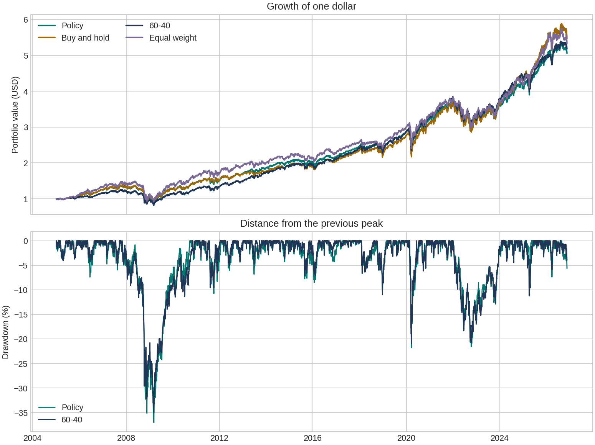

# Five ETFs versus 60/40

Would adding international stocks, listed real estate, and gold have softened the worst loss in a US stock-and-bond portfolio? From January 2005 through November 2026, the five-ETF portfolio experienced a 37.03% maximum drawdown, compared with 34.99% for the 60/40 benchmark. It also earned a slightly lower annualized return.



## Portfolio design

The five-ETF portfolio allocated 35% to US stocks (SPY), 15% to developed international stocks (EFA), 30% to US bonds (AGG), 10% to listed real estate (VNQ), and 10% to gold (GLD). The benchmark held 60% SPY and 40% AGG.

## Results

| Strategy | Annualized return | Annualized volatility | Maximum drawdown |
|---|---:|---:|---:|
| Five ETFs, quarterly rebalancing | 7.69% | 11.85% | −37.03% |
| Same five ETFs, buy and hold | 8.08% | 12.20% | −34.74% |
| 60/40 benchmark, quarterly rebalancing | 7.81% | 11.26% | −34.99% |
| Five ETFs, equal weights, quarterly rebalancing | 7.95% | 13.02% | −38.63% |

## What drove the gap in 2008?

From May 19 to November 20, 2008, the five-ETF portfolio lost 34.58% while the benchmark lost 30.53%. Holding less US equity helped relative performance by 12.44 percentage points. International stocks and listed real estate together reduced relative performance by 15.08 points, more than offsetting that benefit.

[Explore the contribution of each asset in 2008, 2020, and 2022](results/stress_attribution.csv)

## Data and methods

- **Source:** Yahoo Finance daily adjusted ETF prices, January 3, 2005 through November 18, 2026. The five ETFs share 5,505 price observations and 5,504 daily returns.
- **Trading assumptions:** Portfolios start with $1. Rebalancing costs 5 basis points per dollar bought or sold. The buy-and-hold portfolio starts at the same target weights and allows them to drift.
- **Risk measurement:** Drawdown is measured from each portfolio’s previous peak, including its starting value. The Sharpe ratio uses a constant 2% annual risk-free rate.
- **Sensitivity analysis:** Monthly, quarterly, and annual rebalancing were tested at trading costs of 0, 5, and 10 basis points. Results describe one historical period and exclude taxes.

## Run the analysis

From the folder containing this README:

```bash
python -m pip install -r requirements.txt
python -m unittest
python analyze_portfolio.py
```

Open `results/report.html` in a browser to read the investment report. The repository includes the price snapshot used to produce the figures.

[Strategy metrics](results/strategy_metrics.csv) · [Rebalancing sensitivity](results/sensitivity.csv)